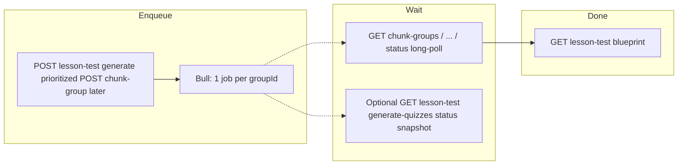

# Lesson test chunk groups — merged-context generation (approach)

Companion to **`lesson-test-api-draft.md`** (HTTP) and **`test-for-lesson-schema-draft.md`** (schema). Describes how **one chunk group** becomes **one merged-context LLM batch**, how **Bull** scales to **many groups**, and **exactly which APIs** wait on work vs return snapshots.

**Gateway prefix in examples:** `/assistant` — full paths are `/assistant/lessons/:lessonId/...`.

---

## 1. End-to-end authoring flow (source of truth)

This is the behaviour authoring UI and backend should implement.

### 1.1 Load blueprint

| Step | API | Purpose |
|------|-----|---------|
| 1 | **`GET .../lessons/:lessonId/lesson-test`** | Returns **`lessonTest`** + **`chunkGroups[]`**. Each row may include **`generation.state`**, **`generation.jobId`**, **`generation.lastError`** so the UI can **resume** after refresh (see API draft **§2.1**). |

### 1.2 Start generation

**Implementation priority:** Build **`POST .../lesson-test/generate-quizzes`** **before** **`POST .../lesson-test/chunk-groups/:groupId/generate-quizzes`**. Both call the **same enqueue helper / Bull processor**; the chunk-group route is a thin single-row facade once bulk works.

Exactly **one** of:

| Trigger | API | Response |
|---------|-----|----------|
| **Whole blueprint (one click)** — **primary** | **`POST .../lesson-test/generate-quizzes`** | **`202`** + **`{ jobs: [{ groupId, jobId }, …] }`**. Optional body **`groupIds`** limits which rows enqueue. |
| **One chunk group** — **secondary API** | **`POST .../lesson-test/chunk-groups/:groupId/generate-quizzes`** | **`202`** + **`{ groupId, jobId }`** (async path). |

Both enqueue **the same worker**: **one Bull job per targeted `groupId`**. Each job runs **one** merged-context LLM call for that row (**not** one job per chunk inside the row).

### 1.3 Wait for completion (long-poll **only** here)

| Step | API | Purpose |
|------|-----|---------|
| 2 | **`GET .../lesson-test/chunk-groups/:groupId/generate-quizzes/status?jobId=…`** | **Long-poll** (up to **`LONG_POLL_TIMEOUT_MS`**, Redis pub/sub **`lesson-test-group-gen:${jobId}`**). Repeat until **`COMPLETED`** / **`FAILED`** or client aborts. |

**Bulk (“generate all”):** run **one long-poll per `(groupId, jobId)`** in **parallel** (same URL shape; different **`groupId`** / **`jobId`** per request).

### 1.4 Optional: bulk status **without** holding connections

| Step | API | Purpose |
|------|-----|---------|
| (optional) | **`GET .../lesson-test/generate-quizzes/status?jobId=…&jobId=…`** | **Snapshot only** — immediate **`200`** + **`items[]`** from Bull state / cache. **No** long-poll. Use for dashboards or periodic refresh between chunk-group long-polls. |

### 1.5 Refresh persisted data

| Step | API | Purpose |
|------|-----|---------|
| 3 | **`GET .../lessons/:lessonId/lesson-test`** | Reload blueprint, quiz counts, and cleared **`generation.jobId`** after jobs finish (TTL / state rules per API draft). |

---

## 2. Goals

| Goal | Detail |
|------|--------|
| **Fewer LLM round trips per row** | One primary generation call per **`lesson_test_chunk_groups`** row (retries are Bull-level, not extra prompts per chunk). |
| **Predictable context size** | Hard token budget on **`mergedContext`**; truncate before calling the model. |
| **Bounded groups** | **`chunk_ids.length` ≤ 3** (API + UI). |

---

## 3. Product constraint: max three chunks per group

- **Server:** **`POST`** / **`PATCH`** chunk groups → **`400`** if **`chunkIds.length > 3`**. Same if **`PUT .../chunk-groups/sync`** exists.
- **Client:** Blueprint UI must not allow a fourth chunk in one row.

---

## 4. Worker pipeline (inside each Bull job)

Order is fixed:

1. **Load** **`lesson_test_chunk_groups`** by **`groupId`**, resolve **`chunk_ids`** ⊆ **`lesson_chunks`** for **`lessonId`**.
2. **Build `mergedContext`** (**§4.1**).
3. **Apply token budget + truncation** (**§4.2–4.3**).
4. **Call LLM once** with batch prompt for **`question_count`** quizzes (**§4.4**).
5. **Persist** quizzes with **`quiz_scope = LESSON_TEST`**, **`lesson_test_chunk_group_id = groupId`** (**§4.4**).
6. **Publish** completion (**§6.2**) so chunk-group status long-polls can finish.

### 4.1 Building `mergedContext`

Chunks ordered **as stored in `chunk_ids`** (pick one rule with lesson order if you merge later).

Per chunk \(i \in \{1..n\}\), \(n \le 3\):

1. Delimiter block: e.g. **`### Chunk <i>`**, optional **`chunk_id:`** for ops (omit in prod if noisy).
2. **`Summary:`** — stored analysis summary (keep intact longer during truncation).
3. **`Content:`** — body/transcript used for grounding.

Concatenate into one string for the user portion of the prompt.

### 4.2 Token budget

- **`LESSON_TEST_GROUP_CONTEXT_MAX_TOKENS`** — budget for the **merged context blob only** (exclude system prompt + JSON instructions + completion reserve).
- Estimate with project tokenizer or heuristic (**e.g.** `ceil(chars/4)`) and document for operators.

### 4.3 Truncation (when over budget)

1. Measure **`mergedContext`**.
2. Under budget → unchanged.
3. Over budget → **truncate `Content:` first** (per chunk; longest-first or round-robin), keep chunk headers.
4. Still over → shorten **`Summary:`** with **`[...truncated]`**.
5. Below **minimum floor** → fail job (**422**/logical error); do not call LLM on empty noise.

Log pre/post truncation estimates at debug level.

### 4.4 Prompt and persistence

- Single batch-style prompt: **`question_count`** questions for the **whole group**, grounded in final **`mergedContext`**.
- Parse with same validation as existing batch quiz JSON (Bloom, choices, etc.).
- **`chunk_id`:** schema requires FK — **default recommendation:** first id in **`chunk_ids`** for every quiz in that run unless product adds smarter mapping later.

---

## 5. Bull + Redis — **one job = one chunk group**

Reuse assistant-service patterns: **`bullQueue.service.ts`**, **`bullRedis.factory.ts`**, and/or **`openaiQueue.service.ts`** (`openai-quiz-generation`) — exact queue name is an implementation choice.

### 5.1 Mandatory rules

| Rule | Meaning |
|------|---------|
| **1 Bull job ↔ 1 group generation** | One job = load row → §4 pipeline → persist. |
| **Never N jobs for N chunks in one row** | Breaks single merged prompt design. |
| **Many groups = many jobs** | **`POST .../lesson-test/generate-quizzes`** adds **one job per targeted row** — **expose this HTTP surface before** single-row **`POST .../chunk-groups/:groupId/generate-quizzes`**. |

### 5.2 Job `data` (required for HTTP validation)

Every enqueue **must** store at least:

- **`lessonId`**, **`groupId`** — so **`GET .../lesson-test/generate-quizzes/status`** and **`GET .../chunk-groups/:groupId/.../status`** can verify **`job.data.lessonId`** (and chunk-group route checks **`job.data.groupId`** matches URL).
- Optional: **`distribution`**, **`userPrompt`** snapshot, **`requestedByUserId`**.

### 5.3 Retries and failures

- Bull **attempts + backoff** like existing quiz queue.
- Final failure: optionally **`publish`** **`FAILED`** on **`lesson-test-group-gen:${jobId}`** (**§6.2**) so long-polls end; update **`generation`** / Redis map for **`GET .../lesson-test`**.

---

## 6. HTTP surfaces & Redis pub/sub

### 6.1 Which route does what

| Route | Long-poll? | Role |
|-------|------------|------|
| **`GET .../lesson-test`** | No | Blueprint + **`generation.*`** hints. |
| **`POST .../lesson-test/generate-quizzes`** | No | **Primary** bulk enqueue → **`jobs[]`** — ship first. |
| **`POST .../chunk-groups/:groupId/generate-quizzes`** | No | Single-row enqueue (**thin wrapper** — ship **after** bulk route shares same processor). |
| **`GET .../lesson-test/generate-quizzes/status`** | **No** | **Snapshot** **`items[]`** via **`getJob` / cache** only. |
| **`GET .../chunk-groups/:groupId/generate-quizzes/status`** | **Yes** | **`LONG_POLL_TIMEOUT_MS`** + subscriber — mirror **`AnalysisService.waitForAnalysis`** style (`~/service/analysis/analysis.service.ts`, **`redisService.createSubscriber()`**). |

### 6.2 Pub/sub channel

- **`lesson-test-group-gen:${jobId}`** — worker (or Bull **`completed`/`failed`** hook) **`publish`**es JSON: **`COMPLETED`** / **`FAILED`**, **`createdCount`**, optional ids, **`reason`** on failure.

### 6.3 Snapshot implementation (`GET .../lesson-test/generate-quizzes/status`)

For each query **`jobId`**: **`getJob(jobId)`** → **`getState()`** (+ optional Redis-cached result after completion). **Do not** **`subscribe`** on this handler.

### 6.4 Client summary

- **Always** use **chunk-group status `GET`** for **blocking wait**.
- Use **lesson-test status `GET`** only for **lightweight multi-job reads**.
- After navigation refresh, **`GET .../lesson-test`** supplies **`jobId`** per row so the UI can restart **§1.3** per active group.

---

## 7. Trade-offs

| Benefit | Cost |
|---------|------|
| One LLM call per group | Possible loss of detail under truncation |
| Max 3 chunks | Authors split wide ranges across rows |
| Chunk-group long-poll matches analysis pattern | **N** parallel waits if **N** groups generate at once (consider UI concurrency limits) |
| Lesson-test snapshot avoids multiplex subscribe logic | Clients poll snapshot if they want a single cheap refresh |

---

## 8. Implementation checklist

- [ ] **`LESSON_TEST_GROUP_CONTEXT_MAX_TOKENS`** (+ truncation floors).
- [ ] **`chunkIds.length <= 3`** on **`POST`/`PATCH`** chunk groups.
- [ ] Shared worker: §4 pipeline; publish §6.2 on terminal states.
- [ ] Bull **`data`**: **`lessonId`** + **`groupId`** on every job.
- [ ] **`POST .../lesson-test/generate-quizzes`** + **`GET .../lesson-test/generate-quizzes/status`** + **`GET .../chunk-groups/.../status`** (**bulk authoring flow first**).
- [ ] Redis (or DB) **`lessonId` + `groupId` → generation`** for **`GET .../lesson-test`** (**API draft §2.1**).
- [ ] **`POST .../chunk-groups/:groupId/generate-quizzes`** — thin wrapper, **after** bulk enqueue works (**API draft §9**).
- [ ] **`GET .../lesson-test/generate-quizzes/status`** = snapshot only (**§6.3**).
- [ ] **`GET .../chunk-groups/.../status`** = long-poll + **`LONG_POLL_TIMEOUT_MS`** + abort on client disconnect.
- [ ] OpenAPI: **400** / **422** as in API draft.
- [ ] UI: max three chunks per row; lead with **§1.2** bulk “one click”; parallel §1.3.
